<div align="center">

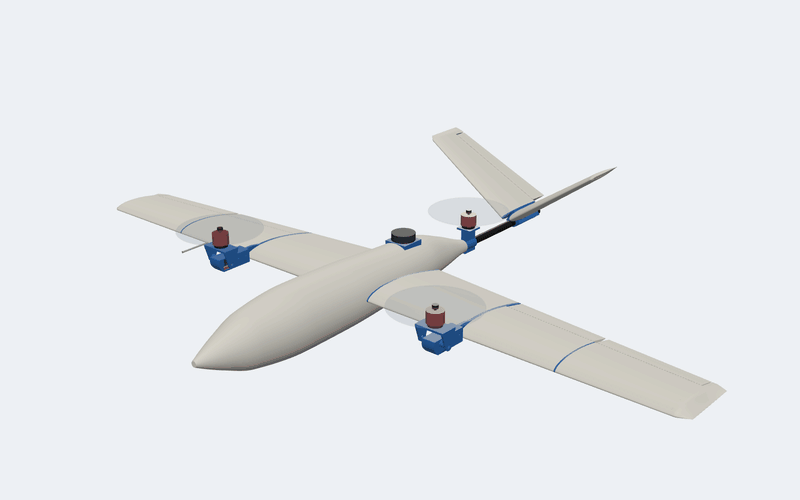

# VTOL Plane

### A 3-D printed tilt-rotor tricopter: it takes off like a drone and flies like a plane

[](https://github.com/AjayaDahal/vtol-plane/actions/workflows/gate.yml)


**[▶ Open the live 3-D viewer](https://ajayadahal.github.io/vtol-plane/)** ·
[Design](DESIGN.md) · [Bill of materials](BOM.md) · [Print tracker](tracker.md) ·
[PX4 setup](PX4_GUIDE.md) · [Review report](REPORT.md)

</div>

Two motors on tilting yokes lift the aircraft in hover and swing forward for cruise; a third,
fixed motor at the tail shares the hover load. In forward flight a Clark Y wing and a V-tail carry
it, under PX4 on a Pixhawk 6C. The airframe is a single-wall LW-PLA shell, printed in vase mode,
over PETG ribs and frames and carbon spars and boom.

Every part is generated by Python from one parameter file, laid out and sliced from the command
line, and checked by an automated gate (fits, flush joints, paths, clearances, balance, hover
margin and the G-code itself) before any filament is used. The gate runs on every push.

## At a glance

| | |
|---|---|
| **Configuration** | Tilt-rotor tricopter VTOL: two front motors tilting −20…90°, one fixed rear lift motor, V-tail |
| **Span · length** | 1478 mm · ~1.1 m |
| **All-up weight** | ~2.0 kg with a 4S 5000 mAh pack |
| **Wing** | Clark Y, flat bottom, straight leading edge, 220 → 150 mm chord, 0.27 m², Hoerner tips |
| **Tail** | V-tail, NACA 0012, 110° included angle, ruddervators |
| **Power** | 3 × Emax ECOII 2807 1700 KV, 7 × 4.5 props, 3 × 50 A DShot ESCs |
| **Avionics** | Pixhawk 6C (PX4), M10 GPS on an external saddle, digital airspeed sensor with pitot, ELRS |
| **Speeds** | cruise ~18 m/s, stall 10–11.5 m/s (estimates) |
| **Hover** | ~7 min pure hover (estimate); front motors kept under 60 % of their thrust |
| **Airframe** | LW-PLA vase-mode skins with fused internal webs, PETG structure, carbon tubes |
| **Printers** | Anycubic Kobra S1 + Kobra X, about 35 h with both running |

Exact numbers (from `scripts/mass_balance.py`): [`DESIGN.md`](DESIGN.md#key-numbers).

## See it move

<table>
<tr>
<td width="50%">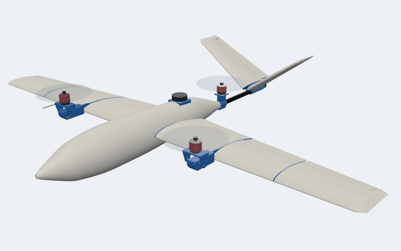<br>
<b>Hover → cruise.</b> The yokes swing the front motors from straight up to straight ahead.</td>
<td width="50%">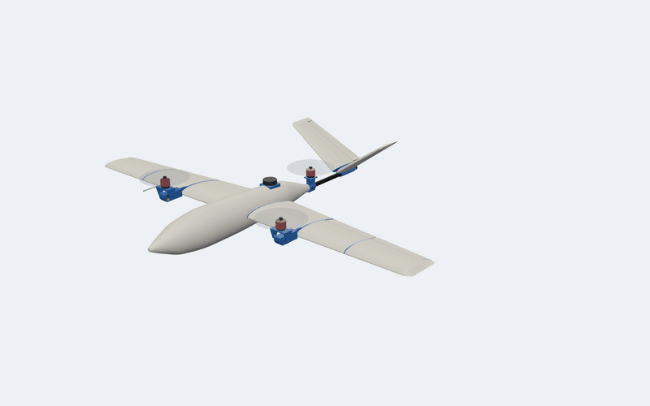<br>
<b>Burst view.</b> Every part moves out along the way it goes together, electronics included.</td>
</tr>
<tr>
<td>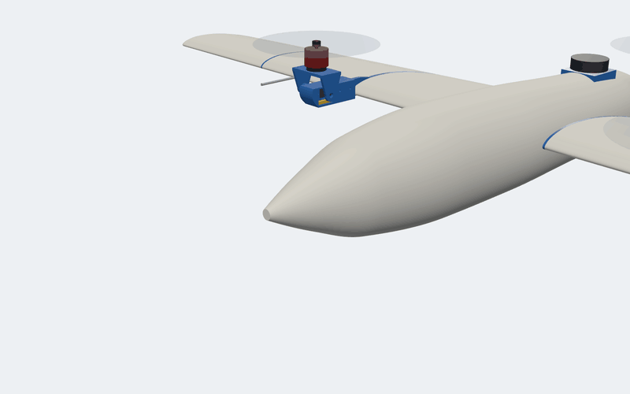<br>
<b>Battery change.</b> One nylon screw holds the nose; the pack slides out through the coupler ring.</td>
<td>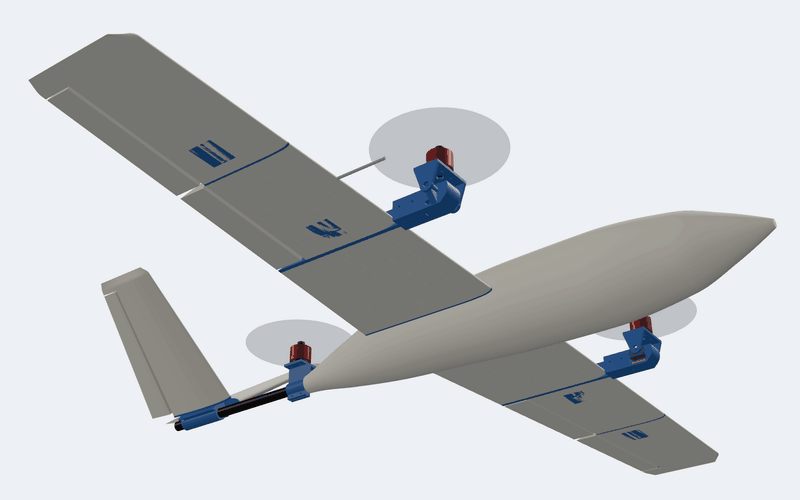<br>
<b>Servicing.</b> Every control servo sits on a screwed hatch, and the yokes lift off their pods.</td>
</tr>
</table>

## Explore it in 3-D

| | |
|---|---|
| ✈️ **[Live viewer](https://ajayadahal.github.io/vtol-plane/)** | The full three.js viewer in your browser: orbit, burst view, battery and service animations, tilt slider, x-ray, section cuts, reflection stripes for checking smoothness, and every print file and PETG plate on its printer's bed with its sliced mass and time. |
| 🧊 **[`renders/vtol_plane.stl`](renders/vtol_plane.stl)** | The outside of the whole aircraft in GitHub's own 3-D viewer: drag to spin, scroll to zoom. |
| 💻 **`python scripts/serve_viewer.py`** | The same viewer from your clone, at <http://127.0.0.1:28765/viewer/>. |

The live viewer is this repository served by GitHub Pages (*Settings → Pages → Deploy from a
branch → `main`, `/ (root)`*); the root `index.html` opens `viewer/`.

## Gallery

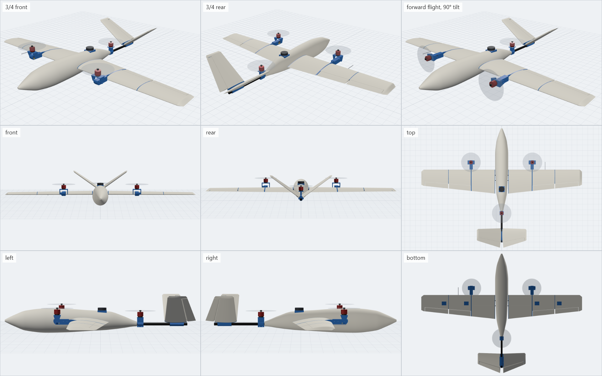

<details>
<summary><b>Wing smoothness</b>: one colour and reflection stripes across every glued joint</summary>
<br>
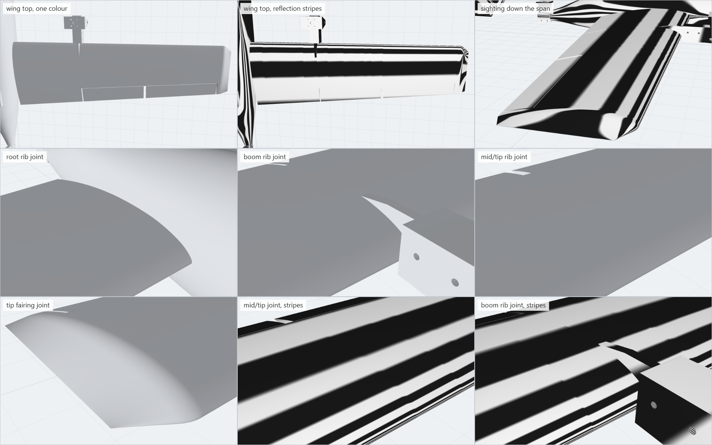

The stripes run straight across every seam: the rib flanges continue the skin's taper, and the gate
holds every glued joint flush to 0.15 mm ([DESIGN.md](DESIGN.md#finish-making-the-glued-wing-read-as-one-piece)).
</details>

<details>
<summary><b>Inside the airframe</b>: burst view, section cuts and the electronics bay</summary>
<br>
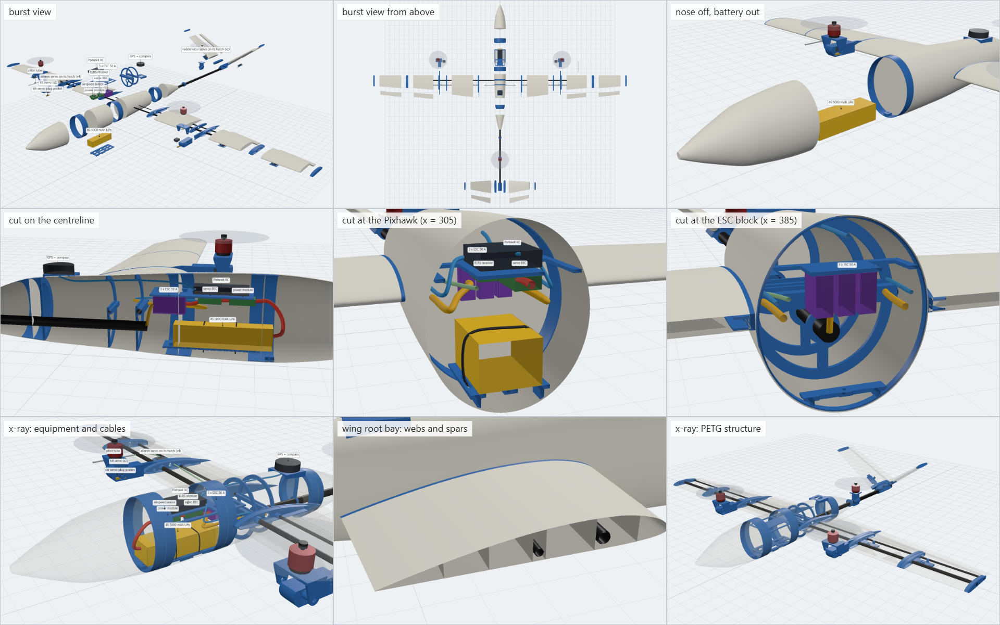
</details>

<details>
<summary><b>Servicing</b>: battery, servo hatches, yokes and tilt servos</summary>
<br>
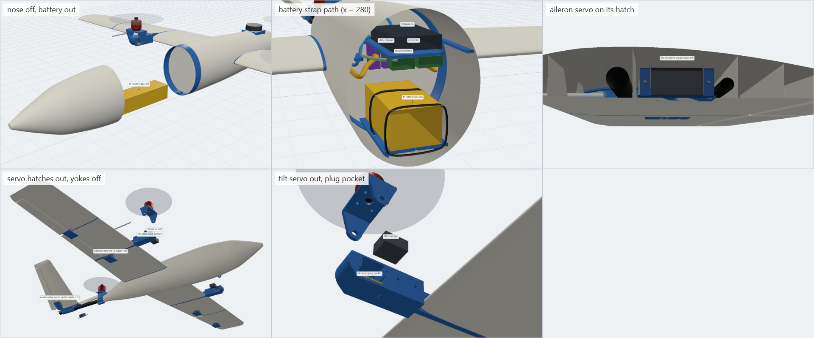
</details>

<details>
<summary><b>Tips</b>: Hoerner wing tips and V-tail tip fairings</summary>
<br>
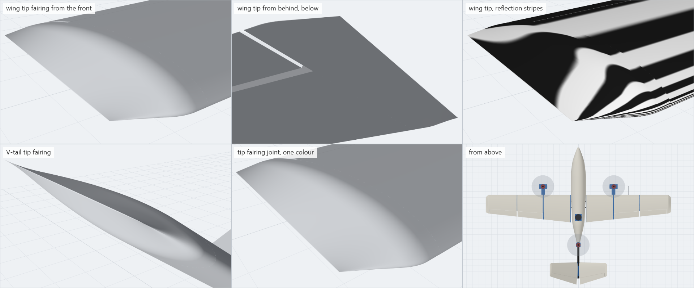
</details>

<details>
<summary><b>Print files</b>: every part and the seven PETG plates on their beds</summary>
<br>
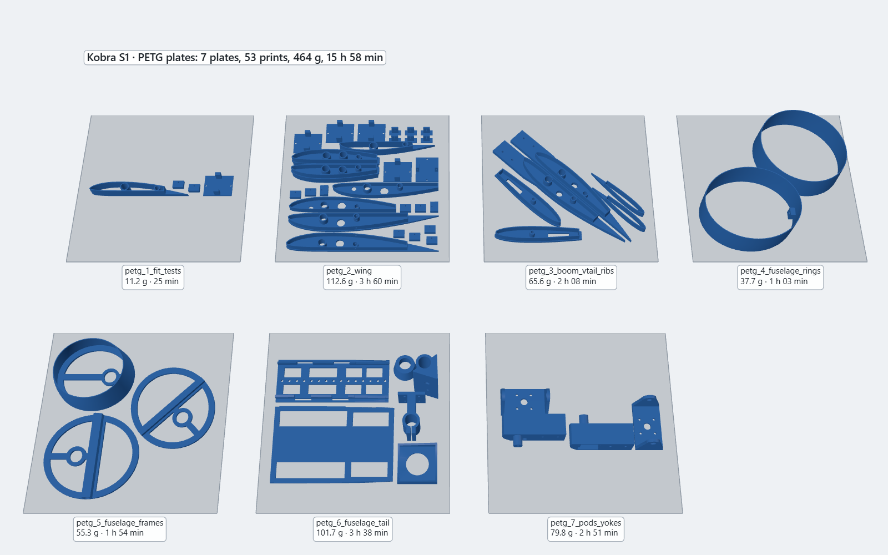
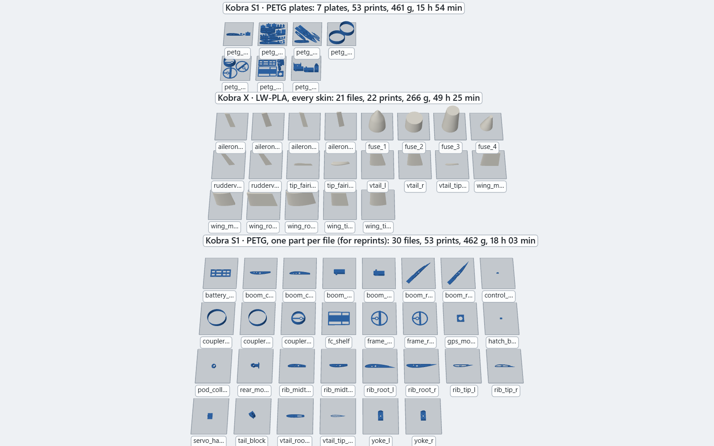
</details>

## How it is built

- **Skins** are LW-PLA printed in vase mode: one continuous ~0.5 mm wall, foamed to about half
  the density of PLA. The wing's root and mid sections carry spanwise webs that the single wall
  runs into and fuses to, so the skin does not oil-can
  ([inside the wing](DESIGN.md#inside-the-wing-ribs-spars-and-webs)).
- **Structure** is PETG: ribs whose spigots the skins slide over, fuselage couplers and frames,
  the tilt-servo pods and yokes, the tail block. Carbon tubes do the bending: 10 mm and 6 mm
  wing spars on joiners, a 16 mm tail boom.
- **Joints read as one piece.** Each rib flange continues the skin's taper; the tips close in
  vase-mode fairings over hidden rings ([tips](DESIGN.md#tips)).
- **Nothing replaceable is glued in.** The nose comes off for the battery and the electronics,
  every control servo is on a screwed hatch, and the tilt servos come out with the yokes
  ([servicing](DESIGN.md#servicing-battery-servos-and-motors)).

## From parameters to G-code

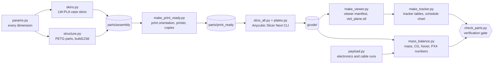

Change a number in `scripts/params.py` and run `python scripts/build_all.py`. It rebuilds every
part, re-slices every file and plate, regenerates the viewer, the tracker and the schedule chart,
and runs the gate.

<details>
<summary><b>What the gate checks</b></summary>
<br>

- **Meshes:** watertight, left and right parts true mirror images, parts printed from one file for
  both sides truly symmetric.
- **Fits:** every spigot, coupler, frame, ring and hatch, with its glue gap.
- **Finish:** every glued skin joint flush and crease-free.
- **Paths:** spars, joiners, the tail boom and every wire route are clear.
- **Mechanism:** motor screw holes with hex-key room, the tilt sweep, and the prop clearances.
- **Balance:** thrust split, CG band, static margin, and the hover margin (front motors at most
  60 % of their near-empty thrust).
- **Printability:** no part needs supports (overhangs are bridges or short ledges), and no vase
  wall leans more than 45°.
- **Equipment:** every item fits clear of the skin and the inserts, the battery slides out
  through the nose, the straps loop round it, and every servo comes out through its hatch.
- **G-code:**
  - every part and plate is present and sliced from the current STL (hash stamps), with no stray
    files;
  - every move is inside the printer's height and every extrusion inside its bed;
  - there are no support moves, and the vase walls print in one speed band;
  - the wing webs print fused, and every part is its own object where the script placed it.
- **Docs:** the viewer manifest, `tracker.md` and the schedule chart match the sliced files.

The results and the reasoning behind every check: [`REPORT.md`](REPORT.md).
</details>

## Printing it

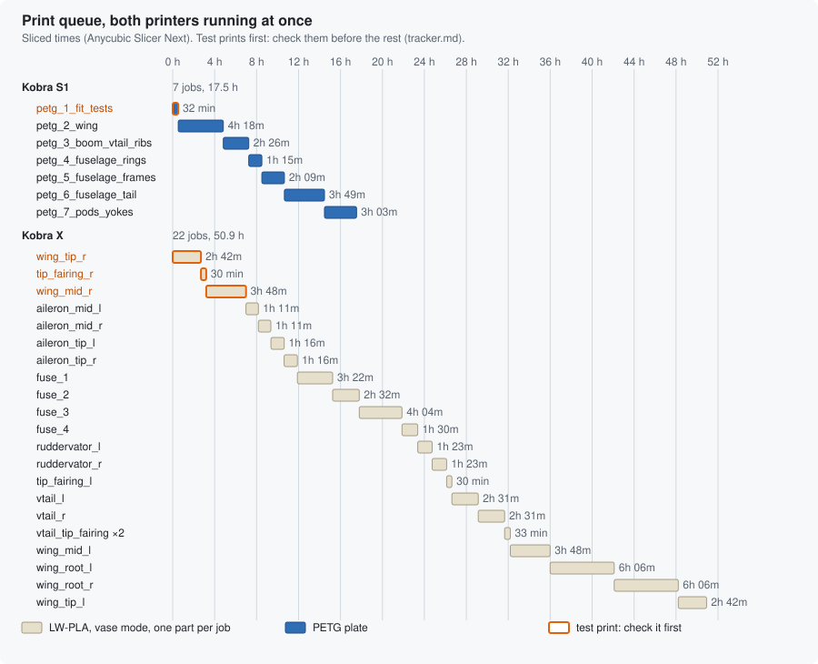

The **Kobra S1** prints the right wing and all the PETG, laid out as seven plates in build order.
The **Kobra X** prints the left wing, the fuselage and the V-tail. The vase skins print one per
job: vase-mode parts can share a bed only by printing one after another, and the skins stand
taller than the print head's gantry clearance. Start with the test prints (orange above).
`wing_tip_r` and `wing_tip_l` check the LW-PLA flow on each printer, and plate `petg_1_fit_tests`
checks the spigot and servo-hatch fits. Then work down [`tracker.md`](tracker.md), which also
carries the [reminders](tracker.md#reminders-for-print-time-agents-raise-these-with-the-user-when-printing-starts)
to tick off along the way. The chart is redrawn from the sliced files on every build.

## Flight setup

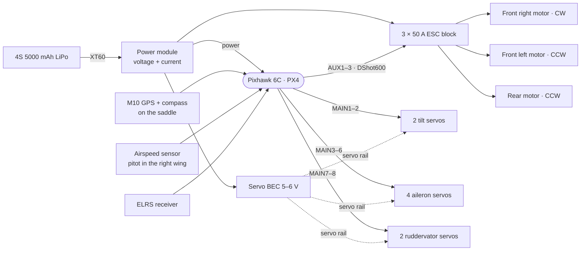

PX4 runs it as a *Generic Tiltrotor VTOL* with three rotors and two tilt servos.
[`PX4_GUIDE.md`](PX4_GUIDE.md) has:

- the rotor geometry and the [output mapping](PX4_GUIDE.md#output-mapping);
- tilt calibration, transition airspeeds and failsafes;
- the [first-flight sequence](PX4_GUIDE.md#first-flight-sequence).

## Quick start

```bash
python -m venv .venv
.venv\Scripts\activate             # Windows; elsewhere: source .venv/bin/activate
pip install -r requirements.txt

python scripts/check_parts.py      # run the gate on the committed files
python scripts/serve_viewer.py     # the 3-D viewer at http://127.0.0.1:28765/viewer/
python scripts/build_all.py        # rebuild, re-slice and verify everything
```

`build_all.py` needs Anycubic Slicer Next 1.3.3.3: set `VTOL_SLICER` if it is not at the default
Windows path, or pass `--no-slice` to rebuild without slicing ([`SLICING.md`](SLICING.md)). To
re-render the pictures and animations after a change, open the viewer with `?capture=1` (or
`?capture=gif` for the animations only) while `serve_viewer.py` runs.

## Repository map

```text
scripts/            Python: generators, slicing pipeline, mass balance and the gate
  params.py           every dimension
  skins.py            LW-PLA vase skins: wing, fuselage, V-tail, control surfaces, tip fairings
  structure.py        PETG parts (build123d)
  payload.py          electronics: size, position and cable runs
  make_print_ready.py the print table: printer, orientation, copies
  plates.py           PETG plate layouts
  slice_all.py        slices every part and plate
  mass_balance.py     mass, CG, hover thrust, PX4 numbers
  make_viewer.py      viewer manifest and renders/vtol_plane.stl
  make_tracker.py     tracker tables and renders/print_schedule.svg
  check_parts.py      the verification gate
  build_all.py        all of the above, in order
  serve_viewer.py     local server for the viewer and its capture mode
parts/assembly/     every part where it sits in the aircraft (STL)
parts/print_ready/  every part as it lies on the bed (STL)
gcode/              s1_lwpla, x_lwpla, s1_petg (one part per file), s1_petg_plates
slicer_profiles/    printer, process and filament profiles
viewer/             the three.js viewer and its manifest
renders/            pictures, animations, the exterior model and the print schedule
```

## Status

**v0.2: designed, sliced and verified; the test prints are next.** On the way to first flight
([`REPORT.md`](REPORT.md#current-status-v02-nov-2-2026)):

1. Test prints: LW-PLA flow on each printer, spigot and servo-hatch fit, the closing tips, the
   wing webs.
2. Measure the tilt servos against the pod bay before printing the pods and yokes.
3. Weigh the real parts and re-run the mass balance. The hover margin is thin.
4. Balance at the design CG, then glide-test.
5. Bench tests with the props off, then the first hover, then transitions at altitude.

**Next design change: the 3S build** ([`PLAN_3S.md`](PLAN_3S.md), not built in yet). The
owner flies his own 3S packs and a Cube Black, with SunnySky X2814 900KV motors on 12 in
props. Modelled, the front motors hover at about half their thrust instead of ~59 %, for about
18 min of pure hover. Only PETG plates 6 and 7 change, so everything else prints now.

## Documentation

| File | What is in it |
|---|---|
| [`DESIGN.md`](DESIGN.md) | configuration, key numbers, parts map, assembly, servicing, hand-drilled holes |
| [`BOM.md`](BOM.md) | everything to buy, and every printed part |
| [`tracker.md`](tracker.md) | every print job and plate, print-time reminders, status |
| [`SLICING.md`](SLICING.md) | slicer profiles, the pipeline and the G-code checks |
| [`PX4_GUIDE.md`](PX4_GUIDE.md) | PX4 setup: geometry, outputs, tilt calibration, airspeeds, first flight |
| [`PLAN_3S.md`](PLAN_3S.md) | the planned 3S build with the owner's parts: motor choice, changes, what to buy |
| [`REPORT.md`](REPORT.md) | every design review and premortem, and the current status |
| [`AGENTS.md`](AGENTS.md) | working notes for AI coding agents on this repository |
