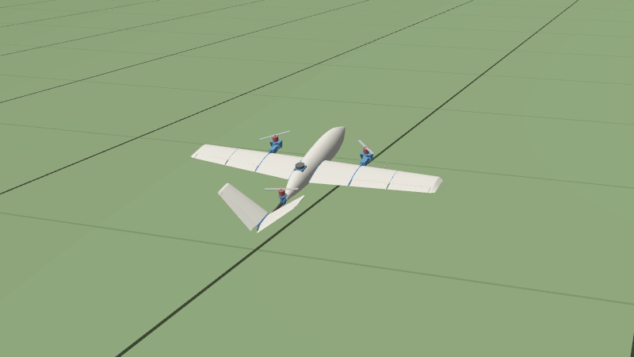
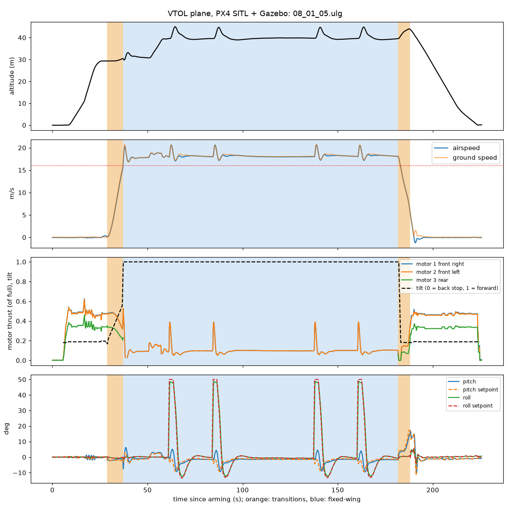

# Flight simulation: PX4 SITL in Gazebo

The aircraft flies in PX4's software-in-the-loop simulation (SITL) with Gazebo Harmonic: the
real PX4 v1.17 flight stack, this airframe's parameters, and a Gazebo model generated from the
design. It flies the mission the real one will: a vertical takeoff, the front transition, a
fixed-wing circuit, the back transition and a vertical landing.

[](renders/sim_flight.mp4)

**[Watch the check flight](renders/sim_flight.mp4)** (3 min 42 s, Gazebo's chase camera; the
still is the back transition). It flies `PX4_GUIDE.md`'s settings, which the simulation and the
premortem changed ([below](#what-the-simulation-changed)): a vertical takeoff to 30 m, the
front transition, a 950 × 400 m circuit at 40 m with four 50° banked turns, the back transition
on a 450 m final, and a vertical landing on the pad. All ten of `fly_test.py`'s checks pass.

| | In the simulation | Expected |
|---|---|---|
| Hover | front motors at 0.47 of their full thrust, rear 0.34 | 0.47 and 0.34: the mass balance's 736 and 528 g of 1550 g |
| Front transition | 8.5 s, past 14 m/s at 7.6 s | at least `VT_F_TRANS_DUR`, 8 s: the tilt ramp |
| Cruise | 18.2 m/s on 0.10 of full thrust; 17.1–20.6 m/s once up to speed | `FW_AIRSPD_TRIM` 18 m/s; 0.096 in this model |
| Fixed-wing control | roll 1.9°, pitch 1.8° RMS from the setpoints, turns included; the turns lift it up to 5 m | |
| Hover control | roll 0.4°, pitch 1.0° RMS | |
| Back transition | 6.6 s from 18 m/s to a hover, climbing 4.4 m, pitch at most 17° | |
| Landing | 0.0 m from home | |



## What the simulation changed

**The front transition ends at 14 m/s, not 18** (`REPORT.md`, 12.1). PX4 held the aircraft
level through the transition (`FW_PSP_OFF` 0), with the motors tilted 40° forward
(`VT_TILT_TRANS`). By about 15 m/s the wing carried the weight, the altitude controller
throttled back, and the motors' forward pull dropped with it: the airspeed levelled off at
15.2 m/s. With `VT_ARSP_TRANS` at 18 m/s, PX4 gave up after 15 s (`VT_TRANS_TIMEOUT`), pitched
up to 48° and flew home in hover. At 14 m/s, 1 m/s above `FW_AIRSPD_STALL`, the transition
completes, and the aircraft speeds up to its 18 m/s cruise as a plane. The real props lose
thrust with airspeed and blow on the wing, which this model does not do, so the first real
transition is still the test of it (`PX4_GUIDE.md`, first-flight sequence).

PX4's default back transition flies as it is: the aircraft noses up to brake, slows from
18 m/s to a hover in about 6.5 s and climbs ~4 m doing it.

**A trap in the model, now avoided** (12.2). Gazebo's physics engine, DART, ignores a servo's
command while its joint rests on a stop. The first model put the stops at the ends of the
commanded range, so the tilt servos, driven to 90° for cruise, stayed there after the back
transition: the front motors kept pushing forward while PX4 asked them to lift. Every back
transition then climbed 18–85 m, dived and zoomed, or tumbled, whatever the settings. The stops
now sit 5° beyond the commanded range (`STOP_MARGIN_DEG` in `make_sim.py`).

**The premortem (round 13) changed three more settings and the failsafes.** `FW_PSP_OFF` is
−2°, the cruise attitude rounded down: the front transition holds it, and flown 2° nose-down
the wing takes the weight later, so the airspeed keeps rising well past 14 m/s even with a wing
that lifts more than modelled. `VT_F_TR_OL_TM` is 12 s: without a valid airspeed the transition
now ends at ~19.5 m/s, not at the tilt ramp's 8 s. The quadchute limits come from
`PX4_GUIDE.md`, and none trips. `THR_MDL_FAC` 0.90 matches this model's thrust curve, so PX4
commands thrust: its hover and cruise settings are now fractions of full thrust.

## Stress tests: the premortem's what-ifs

`sim/variant.py` changes the model installed in the PX4 tree (never the generated files in
`sim/`): heavier, with less thrust, with a wing that lifts more, without the airspeed sensor,
with slower motors. `sim/install.sh` puts the design back. Each variant flew the check mission
(`REPORT.md`, round 13):

| Variant | Stands for | Result |
|---|---|---|
| the design, full pack | | 10/10. Front motors at 47 % of their thrust in hover, peaks 54 % |
| 10 % heavier, near-empty 4S pack | a build heavier than estimated, at the end of a flight | 10/10. Front motors 63 %, peaks 74 % |
| 20 % heavier, near-empty 4S pack | | 10/10. Front motors 69 %, peaks 81 % |
| the 3S plan's build, near-empty pack: 2.29 kg, X2814 thrust, 12 in props' slower spin-up (80 ms) and torque | `PLAN_3S.md` | 10/10. Front motors 48 %, peaks 56 %; hover roll error 0.9° RMS against ~0.5° |
| no airspeed sensor, PX4's `VT_F_TR_OL_TM` (6 s) | a loose plug, a blocked pitot | the transition ends with the tilt ramp after 8.5 s, at 15 m/s; circuit flown on `FW_THR_TRIM`; lands at home |
| no airspeed sensor, 12 s | | the transition ends after 13.7 s at ~19.5 m/s; lands at home |
| a wing lifting as if set 1.5° steeper, transition held level (`FW_PSP_OFF` 0) | the lift at that attitude is an estimate, and the props blow on the wing | 10/10, but 14 m/s only after a 2.7 m climb. Asked for 18 m/s it balloons 12 m, times out and quadchutes |
| the same wing at −2° | | 14 m/s at 8.4 s, 0.7 m up; it would reach 18 m/s |
| the design wing at −2°, asked for 18 m/s | | reaches it (held level it levelled off at 15.2 m/s) |

In calm air every 4S variant flies, but the headroom shrinks from 46 % to 19 %: that is what a
gust, the pack's sag under load and a sinking back transition draw on, and the simulation has
none of them. The 3S build keeps the design's full-pack headroom to the end of its pack.

What the stress tests cannot show: wind (gz-sim's airspeed sensor holds a zero wind, and the
lifting surfaces ignore flow along the span), the pack's sag as the current rises, the props'
thrust falling with airspeed and their wash over the wing.

```bash
sim/install.sh ~/PX4-Autopilot
python3 sim/variant.py ~/PX4-Autopilot --mass 1.10 --thrust 0.806
# start PX4 as in "Running it", then fly it; a variant without the airspeed sensor
# also needs --param SYS_HAS_NUM_ASPD=0, or PX4 will not arm
python3 sim/fly_test.py
```

## The model

`scripts/make_sim.py` writes it from the design, so it follows every change. `build_all.py` and
`slice_all.py` run it, and the gate fails when `sim/` no longer matches the design.

| | From | In the model |
|---|---|---|
| Mass, CG, inertia | every row of `mass_balance.py` (2.00 kg, hover CG 437.7 mm aft of the nose tip), each placed in 3-D: printed parts spread over their assembly STLs, equipment as `payload.py`'s boxes, spars and boom as rods | a base link, two tilting yokes with their motors, three props and six control surfaces. Base link: Ixx 0.090, Iyy 0.070, Izz 0.156 kg·m² |
| Rotors | `PX4_GUIDE.md`'s positions and directions; `mass_balance.py`'s 1550 g full-pack thrust | Gazebo's motor model: thrust ∝ speed², prop torque 0.0127 m × thrust, 25 ms spin-up |
| Tilt | the yoke pivots (x = 315, y = ±280), −20…90° | position servos, 0.1 s per 60°, as the 12 mm servos; their stops 5° outside that range, since Gazebo holds a servo that rests on its stop |
| Wing | Clark Y planform, the hinge lines, both ailerons per side | three lifting strips a side; lift slope 4.84/rad (aspect ratio 7.55), zero lift 5.5° below the flat bottom (the camber line), stall at CL 1.1; aileron effectiveness from the 75 % hinge (thin-airfoil theory, × 0.8 for the taped gap) |
| V-tail | panels at 35°, ruddervators at 70 % chord | each panel split into a pitch and a yaw element (cos² and sin² of the dihedral), downwash 0.41 |
| Drag | | parasitic CD0 0.04 on the wing area, induced drag at e = 0.8: L/D 6.7 at 18 m/s |
| Stability | `mass_balance.py`: neutral point x = 468, static margin 18 % | neutral point x = 465, static margin 16 % (the gate keeps them within 3 %) |
| Sensors | | IMU, barometer, magnetometer, GPS, and the airspeed sensor at the pitot's place in the right wing |
| Looks | the assembly STLs | the parts that show, in their print colours; motors and props as the viewer draws them |

The PX4 airframe, `sim/airframes/22100_gz_vtol_plane`, is `PX4_GUIDE.md`'s, with Gazebo's
outputs in place of the Pixhawk's:

| `PX4_GUIDE.md` | Function | Simulation |
|---|---|---|
| AUX1–3 | motors: front right (CW), front left, rear | `SIM_GZ_EC_FUNC1–3`, rotors 0–2 |
| MAIN1–2 | tilt servos right, left (−20…90°, yaw) | `SIM_GZ_SV_FUNC1–2` (Servo 7–8), disarmed at 0° (motors up) |
| MAIN3–6 | ailerons: right mid, tip; left mid, tip (±25°) | `SIM_GZ_SV_FUNC3–6` (Servo 1–4) |
| MAIN7–8 | ruddervators right, left (±25°) | `SIM_GZ_SV_FUNC7–8` (Servo 5–6) |

The rotor geometry (`CA_ROTORn_PX/PY`) comes out of the model's hover CG: 0.123 / ±0.280 m
for the front rotors and −0.342 m for the rear one, the guide's 0.12 / ±0.28 / −0.34. The
airspeeds are the mass balance's; the transition settings and the quadchute limits are the
guide's, as the simulation and the premortem set them ([above](#what-the-simulation-changed)).
Only the throttles are this model's own (`THR_MDL_FAC` 0.90 and thrust fractions): never copy
them to the real aircraft.

The world, `sim/worlds/vtol_field.sdf`, is PX4's default world (its physics, magnetic field and
home position) with a grass field marked every 50 m, for a sense of speed and height, and a
landing pad at home.

**What it leaves out:** the props' wash over the wing and tail; the drop in a prop's thrust
with airspeed (Gazebo keeps the static thrust at any speed, so the cruise throttle is lower than
the real one); the pack's voltage sag; wind and turbulence; ground effect. The stall is a
straight-line drop in lift. The lifting surfaces apply no force unless the air meets them from
ahead, so in the vertical climb, as the aircraft drifts a few cm/s fore and aft, they switch on
and off, and it rocks ±1.5° in pitch at 0.65 Hz (`REPORT.md`, 12.3); the hover and the descent
are steady. It checks the setup, the control and the transitions' logic, not the last few
percent of the performance.

## Running it

It needs Linux with PX4 v1.17 and Gazebo Harmonic: Ubuntu 24.04, or Ubuntu 24.04 under WSL2 on
Windows (that is how it was run here). Once:

```bash
git clone --branch v1.17.0 --recursive https://github.com/PX4/PX4-Autopilot.git ~/PX4-Autopilot
bash ~/PX4-Autopilot/Tools/setup/ubuntu.sh --no-nuttx     # toolchain and Gazebo Harmonic
```

Then, from this repository, again whenever `make_sim.py` has rewritten `sim/`:

```bash
sim/install.sh ~/PX4-Autopilot           # the model, the world and the airframe, into PX4
cd ~/PX4-Autopilot
make px4_sitl gz_vtol_plane              # Gazebo's window and PX4; HEADLESS=1 make ... runs without the window
```

Fly it from QGroundControl, which finds PX4 by itself on the same machine, or run the
automated check flight in a second terminal:

```bash
python3 sim/fly_test.py --plot flight.png --video flight.mp4
```

`fly_test.py` flies the mission above and checks each phase: the transitions happen, the
airspeed stays between 1 m/s under `FW_AIRSPD_MIN` and `FW_AIRSPD_MAX` once settled in
fixed-wing flight, the back transition climbs no more than its starting airspeed can account
for and never pitches past 45°, and the aircraft lands at home and disarms. It then reads PX4's
log of the flight for the hover and cruise throttles, the transition times and how well attitude
was tracked. `--plot` draws the log; `--param NAME=VALUE` sets a PX4 parameter before the
flight, to try a change.

**Filming.** `--video` films the flight from a chase camera (`sim/chase_cam.py`): Gazebo's
`CameraVideoRecorder` records a camera that its `VelocityControl` system flies behind the
aircraft, so the picture stays steady. Rendering holds the simulation back to the renderer's
pace; PX4 runs in lockstep with it, so the flight is the same and the video plays in simulated
time. To make a small copy for the repository (about 1.5 MB a minute):

```bash
ffmpeg -i flight.mp4 -c:v libx264 -preset slow -crf 31 -pix_fmt yuv420p -movflags +faststart -an renders/sim_flight.mp4
```

### Under WSL2

- `wsl --install -d Ubuntu-24.04`, then the steps above inside it.
- **GPU:** Mesa may fall back to software rendering (llvmpipe), which films about three times
  slower. `export GALLIUM_DRIVER=d3d12` before `make` uses the GPU through Direct3D 12;
  `glxinfo -B` (package `mesa-utils`) shows which one is in use.
- **Behind a TLS-inspecting proxy:** copy the proxy's root certificate into
  `/usr/local/share/ca-certificates/` and run `sudo update-ca-certificates`, or `git` and `pip`
  fail on certificates.
- **If the recursive clone stalls** on a large submodule, SITL needs only these:
  `src/modules/mavlink/mavlink` (with its own submodules), `src/lib/events/libevents`,
  `Tools/simulation/gz`, `src/modules/uxrce_dds_client/Micro-XRCE-DDS-Client`,
  `src/lib/heatshrink/heatshrink` and `src/drivers/gps/devices`.
- **QGroundControl on Windows:** PX4 sends to UDP 14550 on localhost. With WSL's mirrored
  networking (`networkingMode=mirrored` under `[wsl2]` in `%UserProfile%\.wslconfig`), localhost
  is shared with Windows. Not tried here: the check flights above ran without it.

## Files

```text
sim/
  install.sh                     copies the model, the world and the airframe into a PX4 tree
  fly_test.py                    the automated check flight
  chase_cam.py                   the chase camera behind --video
  variant.py                     stress variants of the installed model (the premortem's what-ifs)
  models/vtol_plane/             generated by scripts/make_sim.py: model.sdf, model.config, meshes/
  worlds/vtol_field.sdf          generated
  airframes/22100_gz_vtol_plane  generated: the PX4 airframe
```

Do not edit the generated files: change the design (`params.py`, `payload.py`,
`mass_balance.py`) or `make_sim.py`, and run `python scripts/make_sim.py`.
